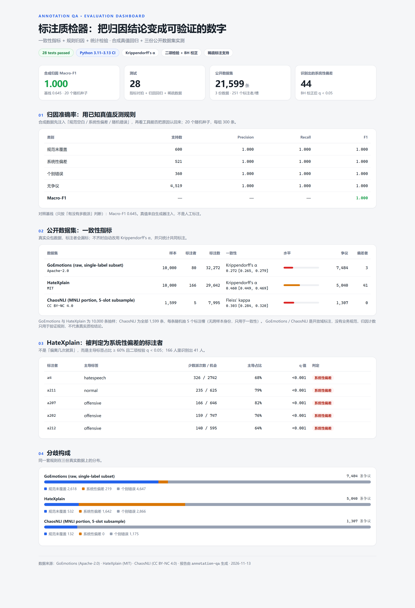
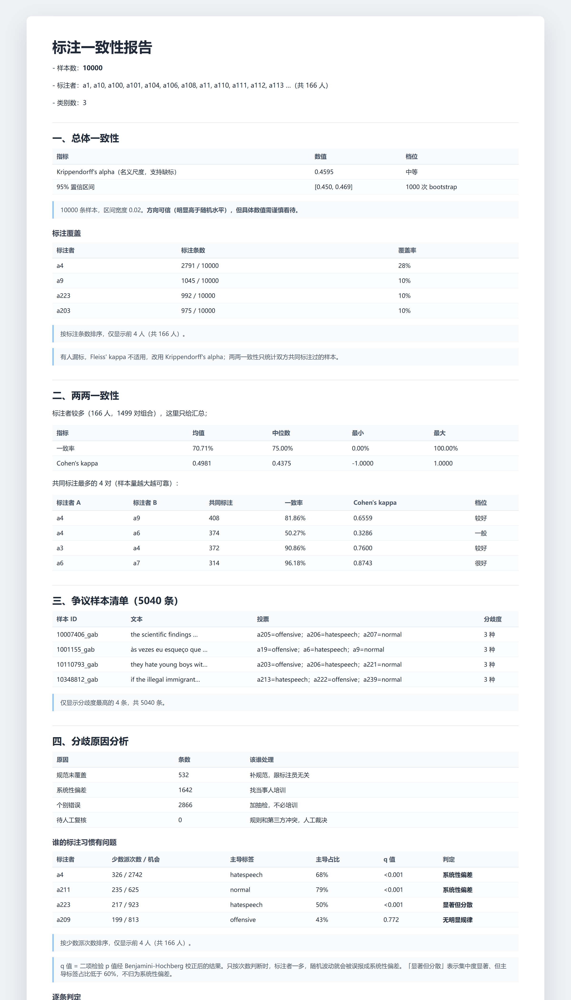
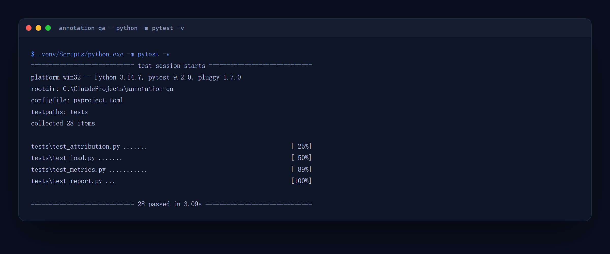

# 标注质检器 · Annotation QA Kit

[](https://github.com/natorshzhong-netizen/annotation-qa/actions/workflows/ci.yml)

> 三个人标同一批数据，结果对不上——到底是规范没写清，还是标注员理解错了？
> 这个工具把「谁跟谁不一致」变成「为什么不一致、该谁去处理」。

**现在它不只给结论，还给出证据：** Krippendorff's alpha 支持漏标，归因规则有二项检验和 BH 多重校正，合成真值上的 Macro-F1 为 1.000（基线 0.645），并在 3 份公开数据集上跑通。



---

## 它解决什么

你是标注组长，接了一批客服工单分类的活。你让 3 个人标同一批数据，标完一对，30 条里有 11 条对不上。你要回答三个问题：

1. **是规范没写清？**（「包装破损能换一个」算退款退货还是商品咨询？规范里没说）
2. **是有人系统性理解错了？**（b 把售后问题都标成商品咨询，一整类都偏）
3. **还是这条本来就是边界样本？**（谁来都得犹豫，两条都对）

三种情况处理方式完全不同：改规范、找人培训、或者不用管。肉眼判断 30 条还勉强，3000 条呢？

**输出：** 总体一致性 → 每条争议的原因 → 本周该做的行动（补规范 / 培训 / 人工裁决 / 加抽检）。

---

## 快速开始

```bash
# 命令行版（纯标准库，无需安装）
python -m src

# 跑别的数据集；允许标注者漏标
python -m src --data-dir path/to/data --allow-missing

# 大数据集只显示每张表前 10 行
python -m src --data-dir path/to/data --allow-missing --max-rows 10

# 加上第三方复核（需要本地 Ollama + qwen3:8b，首次约 6-8 分钟）
python -m src --llm

# 网页版（需要 gradio）
pip install gradio
python app.py
```

网页版用的 CSV 格式：`id, text, annotator, label`，一行 = 一个人对一条样本的标注。可以直接用 `data/sample.csv` 试。

---

## 评测

### 1. 归因准确率：用已知真值反测规则

真实数据里没人知道某条分歧到底是「规范问题」还是「人的问题」，所以归因没法直接算准确率。合成数据反过来做：先注入原因，再看工具能不能认回来。

```bash
python eval/run_attribution_eval.py --seeds 20 --items 300
```

| 类别 | 支持数 | Precision | Recall | F1 |
|---|---|---|---|---|
| 规范未覆盖 | 600 | 1.000 | 1.000 | 1.000 |
| 系统性偏差 | 521 | 1.000 | 1.000 | 1.000 |
| 个别错误 | 360 | 1.000 | 1.000 | 1.000 |
| 无争议 | 4,519 | 1.000 | 1.000 | 1.000 |
| **Macro-F1** | | | | **1.000** |

> 基线（只按有没有多数派判断）的 Macro-F1 是 **0.645**。在 5% 未知原因噪声下，Macro-F1 仍为 1.000，噪声争议会被识别为「原因不明」并从分母排除。
> 这不是说真实数据也能 100%——它验证的是规则实现没有跑偏。真实数据请看下一节。

### 2. 公开数据集实测

报告和截图中的数字来自三份公开多标注者数据集。转换规则、下载地址和复现命令见 [`benchmarks/README.md`](benchmarks/README.md)。

| 数据集 | 样本 | 标注者 | 一致性 | 95% CI | 争议 | 识别出的系统性偏差者 |
|---|---|---|---|---|---|---|
| GoEmotions | 10,000 | 80 | Krippendorff's α **0.272** | [0.265, 0.279] | 7,484 | 3 |
| HateXplain | 10,000 | 166 | Krippendorff's α **0.460** | [0.449, 0.469] | 5,040 | 41 |
| ChaosNLI | 1,599 | 5 槽 | Fleiss' κ **0.303** | [0.284, 0.320] | 1,307 | 0（无跨样本身份） |

HateXplain 上识别出的偏差者例子：

| 标注者 | 主导标签 | 少数派次数 / 机会 | 主导占比 | q 值 |
|---|---|---|---|---|
| a4 | hatespeech | 326 / 2,742 | 68% | <0.001 |
| a211 | normal | 235 / 625 | 79% | <0.001 |
| a207 | offensive | 166 / 646 | 82% | <0.001 |

> 固定阈值会把大量随机波动报成系统性偏差；加入二项检验 + BH 后，10,000 条数据、166 位标注者中识别出 41 人。
>
> GoEmotions 与 ChaosNLI 是开放域标注，不存在业务规范；它们的归因结果只用于验证规则，不代表这两份数据真的有几千条「规范问题」。

报告长这样（HateXplain，每张表限 4 行）：



重新生成截图（需先按 [`benchmarks/README.md`](benchmarks/README.md) 准备数据和紧凑报告）：

```bash
python eval/make_screenshots.py
```

### 3. 测试与 CI

```bash
pip install pytest scikit-learn krippendorff statsmodels
python -m pytest -q          # 28 个测试
```

覆盖指标对拍（scikit-learn / krippendorff 参考实现，误差 < 1e-9）、归因回归、稀疏数据、重复 id、CSV 校验。CI 跑 Python 3.11 / 3.12 / 3.13；截图中的 3.14.7 是本机环境。



---

## 它怎么判断

```
多人标注（允许漏标）
      ↓
  ① 一致性指标
      数据齐 → Fleiss' kappa
      有人漏标 → Krippendorff's alpha（名义尺度）
      所有指标都给 bootstrap 95% 区间
      ↓
  ② 每个标注者的「少数派画像」
      当了几次少数派 / 有几次机会 / 往哪个标签偏
      ↓
  ③ 三条规则判归因
      没有多数派               → 规范未覆盖
      少数派 + 主导标签占比≥60% → 系统性偏差
      少数派但方向分散          → 个别错误
      ↓
  ④ 统计把关
      二项检验：主导标签的集中度是否显著高于全体
      BH 校正：标注者越多，越要控制误报
      ↓
  ⑤ 本地模型只读规范、不看人类答案，盲判一遍
      模型说「无法确定」  → 改判规范未覆盖
      模型和多数派一致    → 维持
      模型和多数派冲突    → 待人工复核（工具不下结论）
```

**关键设计：** 规则只看「这个人有没有习惯」，看不见「这条本身是否模糊」。所以最后一步让模型做独立复核——它是没参与讨论的第三方，能打破「大家都这么标」的共谋。

---

## 目录

```
annotation-qa/
├── app.py                    网页版（Gradio，不含算法）
├── data/                     30 条构造数据 + 三人标注
├── src/
│   ├── load.py               JSONL 读取与校验
│   ├── load_csv.py           CSV 读取与校验
│   ├── metrics.py            一致率 / Cohen κ / Fleiss κ / Krippendorff α / bootstrap
│   ├── classify.py           归因规则 + 二项检验 + BH 校正
│   ├── llm.py                本地模型盲判规范覆盖度
│   ├── report.py             六节 Markdown 报告
│   └── __main__.py           命令行入口
├── eval/
│   ├── generate.py           带真值的合成数据生成器
│   ├── run_attribution_eval.py  归因准确率评测
│   ├── summarize_benchmarks.py  公开数据集汇总
│   └── make_screenshots.py   仪表盘 / 测试 / 报告截图
├── tests/                    28 个测试
├── benchmarks/               公开数据集转换与 1,000 条抽样
├── docs/screenshots/         评测截图
└── .github/workflows/ci.yml  CI
```

---

## 数据格式

```
data/
├── items.jsonl       {"id": "T01", "text": "..."}
├── labels.json       {"labels": ["退款退货", ...]}
├── ann_a.jsonl       {"id": "T01", "label": "退款退货"}
├── ann_b.jsonl
└── ann_c.jsonl
```

- 三个人必须覆盖同一批样本；真实漏标数据加 `--allow-missing`。
- 每条样本至少 2 个人标过。
- 重复 id、未定义标签、不存在的样本会被直接拦下，并指出具体的 id / 标签；重复 id 会带行号。

---

## 已知局限

1. **全体一致但全错**：三个人一起标错时，kappa 会很高，工具看不出来。只能靠金标或专家抽检。
2. **规范自相矛盾**：工具只会说「没覆盖」，说不出「哪两条打架」。
3. **从众**：新人抄旁边的答案，一致但没判断，工具看不出来。
4. **「无多数派 = 规范未覆盖」是规则假设**：真实数据里也可能是三个人都判断失误，工具没有反事实真值可以区分。
5. **归因只到「人 / 规范 / 随机」这一层**，不判断具体哪条规范该改。
6. **小样本的区间很宽**：30 条时 CI 宽度约 0.28，方向可信、数值不可当真；要下结论得标到 100 条以上。
7. **二项检验把同一标注者的每次偏离近似看作独立事件**；真实标注存在相关性，q 值偏乐观，所以它只用来筛人，不当作法律证据。
8. **只认「集中在单一标签」的偏差**：一个标注员在多个类别上各有偏差时，可能只显示为「显著但分散」，不会被判为系统性偏差。

---

## 与现有工具的关系

| 类型 | 代表 | 能做什么 | 缺什么 |
|---|---|---|---|
| 统计库 | [iaa-kit](https://pypi.org/project/iaa-kit/)、[bonepick](https://pypi.org/project/bonepick/) | kappa、alpha、置信区间、混淆矩阵 | 只出数字，不解释 |
| 标注平台 | [CVAT](https://docs.cvat.ai/docs/qa-analytics/quality-control/) | GT job、埋雷题、质量报告 | 无经典 kappa、无归因 |
| 标注平台 | Label Studio 开源版 | — | IAA 需导出自算 |

**这个项目没有重复造轮子的部分：** 算一致率、画混淆矩阵，别人都有；埋雷题 CVAT 早就内置。
**差异点在归因**——把分歧分成「规范 / 人 / 随机」，并输出「该谁处理」；现在这项结论有统计检验和合成真值回归支撑。

---

## 关于 AI 辅助

这个项目的代码不是一个人从零手敲的，分工是：

| 部分 | 谁做的 |
|---|---|
| 问题定义、指标选择、归因规则、复核机制 | 与 AI 共同讨论确定 |
| 代码实现 | AI 编写，作者逐行理解并验证 |
| 结果判定 | 作者人工核对，**发现并纠正过一处误判**（T20） |

**能讲清「为什么这么设计」，比「能默写代码」更接近真实工作要求。**
